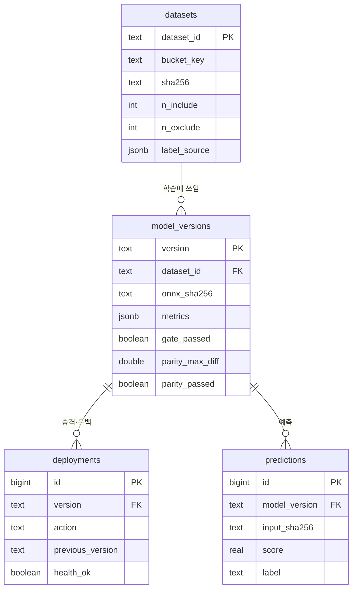

# 데이터 모델 — PostgreSQL 장부

## 목적

모델이 어떤 데이터로 만들어졌고, 게이트·parity 를 통과했는지, 언제 누가 승격·롤백했는지, 운영에서 어떻게 예측하고 있는지를 한 곳에서 질의한다. 결정 근거는 [ADR-002](../decisions/ADR-002-postgresql.md).

## 버킷과의 역할 분담

| 무엇 | 정본 | 다른 쪽에는 |
|---|---|---|
| 모델 파일(onnx)·데이터셋 파일 | 버킷 | DB 는 키와 SHA-256 만 |
| 서버가 올릴 판 | 버킷 `current.json` | DB `deployments` 에 같은 사건을 기록 |
| 이력·지표·예측 로그 | DB | 버킷에는 없음(백업 덤프만) |

순서 규칙: 승격은 ⓪ DB `datasets`·`model_versions` 기록 → ① 서버 교체 → ② `/health` 확인 → ③ DB `deployments` 기록 → ④ 버킷 `current.json` 마지막(⓪ 은 [ADR-009](../decisions/ADR-009-ledger-writer.md), 롤백은 ①부터). 중간에 실패하면 `current.json` 은 이전 판 그대로다.

## 구성도

## 테이블

| 테이블 | 한 행 = | 핵심 제약 |
|---|---|---|
| `datasets` | 버킷에 올린 라벨 스냅샷 1개 | `sha256` 유일, 라벨 출처(`label_source`: 교사 모델·프롬프트 버전·사람 검수 수) |
| `model_versions` | 학습 실행 1회의 산출 모델 | 버전 형식 `m<YYYYMMDD>-<run번호>`, 게이트·parity 결과 |
| `deployments` | 승격 또는 롤백 1건 | `action` 은 promote / rollback, **게이트·parity 를 둘 다 통과한 모델만** 들어갈 수 있다(트리거로 강제) |
| `predictions` | 운영 예측 요청 1건 | 원문(제목·초록)은 저장하지 않고 해시·길이만 |

뷰 `current_model` = `health_ok` 인 마지막 배포의 버전. 뷰 `previous_model` = 그 바로 앞 버전(롤백 대상).

## 인터페이스

- 스키마 파일: `db/init/001_schema.sql` (컨테이너 최초 기동 때 자동 실행)
- 개발 실행: `db/compose.yml`, 접속 정보는 `db/.env`(git 제외) — 예시는 `db/.env.example`
- 쓰는 쪽: 서버 self-hosted 러너의 `promote` 잡(datasets · model_versions — 학습 잡의 모델 카드를 받아 기록), 승격·롤백 잡(deployments), API(predictions, localhost) — [ADR-009](../decisions/ADR-009-ledger-writer.md)

## 미해결

- ~~운영 DB 위치(같은 인스턴스 compose / Lightsail 관리형)와 백업 주기~~ → 같은 인스턴스 compose, pg_dump 매일 1회·승격·롤백 직후 — [ADR-008](../decisions/ADR-008-ledger-db-ops.md)
- ~~GitHub 호스팅 runner(학습 잡)가 DB 에 어떻게 쓸지~~ → 서버 runner 의 `promote` 잡이 모델 카드를 받아 기록 — [ADR-009](../decisions/ADR-009-ledger-writer.md)
- 예측 로그 보관 기간
