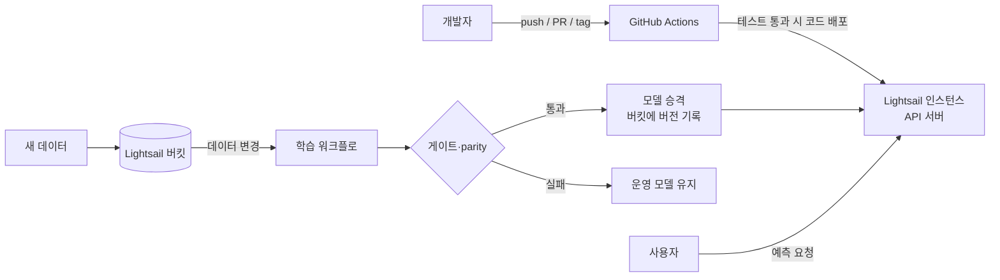
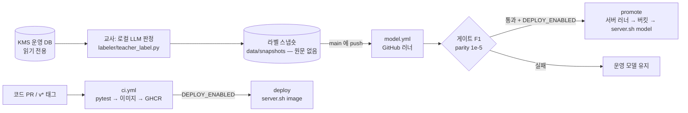

# 아키텍처 개요

> 초안이다. 구성은 [강의 03](../sources/lecture-index.md#공통-개념)의 "판은 둘 — 코드 판과 모델 판" 구분을 따른다. 구체 기술 선택은 [결정 기록](../decisions/index.md)에서 확정한다.
> 강의 아키텍처는 하나의 예시다([과제 브리프](../sources/project-brief.md#설계-원칙--정답은-없다)). 이 그림은 발표 [아키텍처 이유와 Flow](../presentation/01-architecture-why-flow.md)의 원본이다.

## 코드 판

[R2 GitHub CI/CD](../requirements/R2-cicd.md). 코드 변경 → 테스트 → 서버 배포. 런북: [코드 배포](../runbooks/deploy-code.md).

## 모델 판

[R3 자동 학습·검증](../requirements/R3-auto-train-validate.md) → [R4 모델 API 배포](../requirements/R4-model-serving.md). 런북: [모델 승격](../runbooks/promote-model.md).

## 롤백

[R5 롤백](../requirements/R5-rollback.md). 런북: [롤백](../runbooks/rollback.md).

## 장부 DB

모델 버전·배포 이력·예측 로그는 PostgreSQL 에 둔다 — [데이터 모델](./data-model.md), [ADR-002](../decisions/ADR-002-postgresql.md). 모델 파일과 `current.json` 의 정본은 버킷이다. 운영 장부는 작업용 서버 `/srv/ledger`(컨테이너 `paperclf-ledger`, 서버 안에서만)에서 돈다 — [ADR-008](../decisions/ADR-008-ledger-db-ops.md)·[ADR-009](../decisions/ADR-009-ledger-writer.md), 2026-11-19.

## 인프라

서버(R1~R5 수행): 작업용 Lightsail `Amazon_Linux_2026_kms`, 고정 IP `54.252.22.31`, HTTPS `https://54-252-22-31.sslip.io` — [작업용 서버 런북](../runbooks/work-server.md). 최종 결과물 게시 서버: `nlpwizard.eta.pyhub.kr` → 연구자 프로젝트 계정 Lightsail `54.253.32.153`(2026-11-20 DNS 변경, 처음 [ADR-003](../decisions/ADR-003-domain-server.md)의 `13.237.237.56` 은 우리 열쇠가 없는 서버였다) — 첫 화면은 KMS 웹(Mac 터널), API 경로는 paperclf. [최종 서버 런북](../runbooks/final-server.md).

공개 API: `/predict` 는 토큰 인증·IP 별 분당 60 제한(v0.1.3), `/health` 는 공개 — [코드 배포 런북](../runbooks/deploy-code.md).

리전: 시드니 `ap-southeast-2`, 버킷도 같은 리전 — [ADR-007](../decisions/ADR-007-region-instance.md).

[R1 Lightsail](../requirements/R1-lightsail.md). 런북: [자원 정리](../runbooks/teardown.md).

## 구현 (2026-11-19, PR [#19](https://github.com/metahomo/miniproject5_kms/pull/19))

| 항목 | 정한 것 | 근거 |
|---|---|---|
| 예측 대상 | 논문 제목·초록 → p(include), 주제 coaching-leadership | [ADR-005](../decisions/ADR-005-student-model-snapshot.md) |
| 모델 | 해싱 글자 n-gram(32,768) → TF-IDF → 로지스틱 회귀, ONNX(double) 서빙 | ADR-005 |
| 서빙 런타임 | Python FastAPI + onnxruntime 컨테이너 1종(Go·Rust 는 만들지 않음), parity 는 원본 sklearn ↔ 서빙 이미지 | [개선점](../presentation/03-improvements.md) |
| 학습 위치 | GitHub 호스팅 러너(`ubuntu-24.04`). 승격·배포·되돌리기만 서버의 self-hosted 러너 | 강의 03 §7.5 |
| 게이트·parity | [ADR-006](../decisions/ADR-006-gate-parity.md) (잠정) | — |

## 미해결

- ~~서버 접근·버킷~~ → 작업용 서버·버킷 `paperclf-models-apse2`, `DEPLOY_ENABLED=true`(2026-11-19)
- SSH 22번 닫기 — 마감 직전(Tailscale 등록됨)
- ~~예측 로그를 장부 DB 에 남기는 방법~~ → API 가 localhost 로 직접 — [ADR-009](../decisions/ADR-009-ledger-writer.md)
