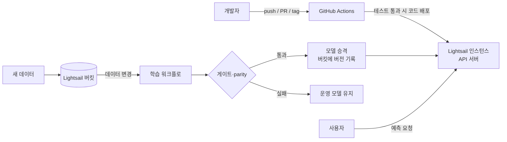

# 아키텍처 개요

> 초안이다. 구성은 [강의 03](../sources/lecture-index.md#공통-개념)의 "판은 둘 — 코드 판과 모델 판" 구분을 따른다. 구체 기술 선택은 [결정 기록](../decisions/index.md)에서 확정한다.
> 강의 아키텍처는 하나의 예시다([과제 브리프](../sources/project-brief.md#설계-원칙--정답은-없다)). 이 그림은 발표 [아키텍처 이유와 Flow](../presentation/01-architecture-why-flow.md)의 원본이다.

## 코드 판

[R2 GitHub CI/CD](../requirements/R2-cicd.md). 코드 변경 → 테스트 → 서버 배포. 런북: [코드 배포](../runbooks/deploy-code.md).

## 모델 판

[R3 자동 학습·검증](../requirements/R3-auto-train-validate.md) → [R4 모델 API 배포](../requirements/R4-model-serving.md). 런북: [모델 승격](../runbooks/promote-model.md).

## 롤백

[R5 롤백](../requirements/R5-rollback.md). 런북: [롤백](../runbooks/rollback.md).

## 장부 DB

모델 버전·배포 이력·예측 로그는 PostgreSQL 에 둔다 — [데이터 모델](./data-model.md), [ADR-002](../decisions/ADR-002-postgresql.md). 모델 파일과 `current.json` 의 정본은 버킷이다.

## 인프라

서버: `nlpwizard.eta.pyhub.kr` (`13.237.237.56`) — [ADR-003](../decisions/ADR-003-domain-server.md).

[R1 Lightsail](../requirements/R1-lightsail.md). 런북: [자원 정리](../runbooks/teardown.md).

## 미해결

- 예측 대상 모델·데이터셋
- 서빙 런타임(Python/Go/Rust, 컨테이너 여부)
- 학습 실행 위치(GitHub 호스팅 러너 / 인스턴스)
