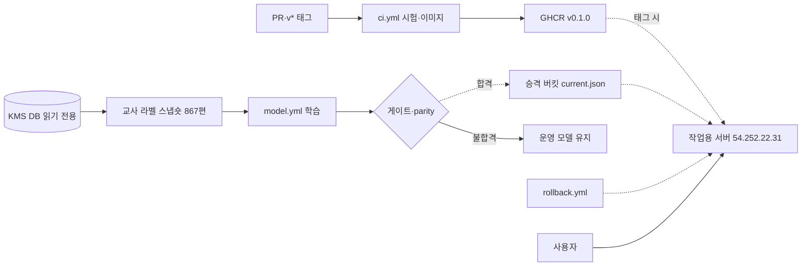

# 조감도 — 미니 프로젝트 5 (마지막 갱신 2026-11-23 12:49)

사령관이 늘 관리하는 1호 목록이다([사령관 지침](../CLAUDE.md) 1절 절대규칙). 이 파일은 이름·위치를 바꾸지 않고, 진행이 바뀔 때마다 이 자리에서 보강한다. 화면판(html)은 `~/.claude/birdseye/build.py` 가 gh 조회로 만든다. 화면으로 보기: `git pull` 뒤 같은 폴더의 `birdseye-update.html` 을 브라우저로 연다.

**웹 주소** — 프로젝트 웹 (KMS 웹 · 접속 암호): <https://nlpwizard.eta.pyhub.kr> · 모델 API 상태: <https://nlpwizard.eta.pyhub.kr/health> · API 소개 · 문서: <https://54-253-32-153.sslip.io/docs> · 발표 덱: <https://metahomo.github.io/md-slides/miniproject5-kms/> · GitHub 저장소: <https://github.com/metahomo/miniproject5_kms>

> **완료 선언 (11-21 19:50, 사령관)** — 발표 전에 할 수 있는 수행이 모두 완료됐다. GitHub 보드 이슈 15/16·PR 29/29 Done, 강의 순서 11/14, KMS 웹 과제 도메인 게시 확인. 남은 것: #11 발표 → 자원 정리(런북 ③), 22번 닫기 결정, AI 활용 검수 칸, Wiki 첫 페이지. **발표 뒤 할 일(11-23 연구자 결정)**: B안 근거 선택 모델(reranker — 질문·논문 → 인용할 근거 점수, 라벨 = 실제 보고서 인용 기록, CPU·ONNX, 같은 model.yml 틀에 게이트·parity·승격).

## 0. 최근 변경 (새로 고침 확인용)

| 시각 | 바뀐 것 |
|---|---|
| 11-23 12:49 | KMS 웹 연구 보고서 삭제(휴지통) 착수(연구자 권장안 체크) — 보고서 화면에만 체크 상자·선택 삭제·같은 질문 중복 정리·휴지통 보기·되살리기, 편집자 이상, 볼트 _trash/ 로 옮김(DB 안 씀). 정리 대상은 1833·1839 두 편(발표 증거 1844·1442 는 남김). 진행: ② 목표 설계·③ 명세 048 작성 중 → G3 점검 → 구현 → 운영 반영 |
| 11-23 12:36 | 러너 실제 작업 확인(연구자 지시) — 12:24 에 다시 offline 으로 보여 같은 모델(m20261121-30) rollback 을 실제로 실행: 두 러너가 바로 받아 25초 성공([45106929109](https://github.com/metahomo/miniproject5_kms/actions/runs/45106929109)), 운영 모델 그대로, 러너 2 online. GitHub 의 offline 표시는 일시적 — 작업 수행에는 문제 없음 |
| 11-23 12:16 | 러너 장애 복구 — 12:09 점검에서 paperclf·paperclf-final 둘 다 GitHub offline(서버 서비스는 실행 중, 연결만 끊김, 11:52 부터). 연구자 승인으로 두 서버 러너 서비스 재시작 → 12:15 "Listening for Jobs", 둘 다 online. 예측 API·KMS 웹 영향 없음 |
| 11-23 11:19 | 발표 덱 넘김 정리(연구자 지시) — 장 안에서 클릭해야 나오던 13곳을 처음부터 표시해 한 번 누르면 다음 장으로, 넘치던 2장(시연 ③·AI 증거) 정리, 표지·절 장 굵은 글 흰색. md-slides e7a25ea — [발표 덱](https://metahomo.github.io/md-slides/miniproject5-kms/) |
| 11-23 11:14 | ⑦~맺음 짧은 리허설(연구자 지시, 운영 두 서버 실제) — 되돌리기 30→24 29초 · 다시 앞으로 24→30 27초(합 56초, 배정 1:00 안), 장부 deployments 10→12, 운영 m20261121-30 복귀 확인. 대본 2-2절에 기록 |
| 11-23 11:06 | 발표 뒤 할 일 추가(연구자 결정) — B안 근거 선택 모델(reranker — 질문·논문 → 인용할 근거 점수, 라벨 = 실제 보고서 인용 기록, CPU·ONNX, 같은 model.yml 틀에 게이트·parity·승격). 발표 전에는 C안(덱 설명 장)만 |
| 11-23 10:47 | 시연 대본 7분판 시간표 — ⑦ 롤백 1:10 → 1:00(실측 26+32초), 맺음 6:50 · 여유 0:10 확보 |
| 11-23 10:35 | 시연 대본(presentation/05-demo-script.md)에 ⑪ "MLOps 틀 설명" 30초 추가 — 덱 25·26장을 ⑧ 장부 뒤·맺음 앞에서 15초씩, 7분판 시간표: 장부 0:40→0:30, ⑪ 0:30, 맺음 7:00(여유 0) |
| 11-23 10:30 | 발표 덱 C안(연구자 체크) — 3절 첫머리에 설명 장 2개: "MLOps 틀은 강의 그대로, 모델만 바꿨다"(단계별 강의 ↔ 이 프로젝트 ↔ 변경) · "모델을 바꾸면 어디가 바뀌나"(train.py·features.py·ONNX 옵션만, 게이트·parity·promote·rollback·ledger 는 그대로인 이유). 교수님 기준 "이해·세팅·이유 설명". 33장, md-slides d98bdf2 — [발표 덱](https://metahomo.github.io/md-slides/miniproject5-kms/) |
| 11-23 10:30 | 첫머리에 웹 주소 게시(연구자 지시) — 프로젝트 웹 nlpwizard.eta.pyhub.kr · 모델 API 상태 /health · API 소개·문서 · 발표 덱 · GitHub 저장소 (11-23 10:29 응답 확인: 웹 401(접속 암호), 나머지 200) |
| 11-23 10:28 | "AI 에게 서비스 제공하기" 절에 **보고서 도우미 LLM** 줄 추가 — KMS 웹 연구 보고서 화면(/research-reports), 작성 qwen3:4b-instruct-2507 · 근거 검색 bge-m3, 실제 생성 5편 · 인용 27/30 |
| 11-23 10:23 | 발표 덱 용어 정리(연구자 지시) — "최종 서버 잡"처럼 어색한 번역어를 영어 원어로: job · version(판) · ledger(장부) · snapshot · test set(시험지) · key hash · rate limit · restore drill · uptime monitoring · runner · artifact · rollback / roll-forward. md-slides 5b3d355 — [발표 덱](https://metahomo.github.io/md-slides/miniproject5-kms/) |
| 11-23 10:21 | 발표 덱에 "보고서 도우미 LLM" 장 추가(4절 끝, 31장) — KMS 웹 연구 보고서 화면의 작성 모델 qwen3:4b-instruct-2507 · 근거 검색 bge-m3 · 참고문헌은 DB 값만, 실제 생성 11-21 14:42 인용 27/30. md-slides df027db, Pages 게시 확인 — [발표 덱](https://metahomo.github.io/md-slides/miniproject5-kms/) |
| 11-23 10:12 | 발표 덱 새 모양(연구자 지시) — 교수님 강의 슬라이드 모양 주황 테마(흰 장·주황 제목 막대·주황 글머리, 절 구분 장은 주황 바탕에 큰 번호, 장마다 꼬리말·쪽 번호), 제목 "KMS 논문 판정기" → "KMS 논문 보고서 작성기", 표지 부제 "가용 가능한 GPU를 점검하여 서버에서 LLM의 판단을 효과적으로 제공하고, 검증을 통과한 것만 운영에 들인다". md-slides 5f11a30, Pages 게시 확인 — [발표 덱](https://metahomo.github.io/md-slides/miniproject5-kms/) |
| 11-21 19:50 | **완료 선언** — 최종 점검: GitHub(보드 이슈 15/16·PR 29/29 Done, 마일스톤 0·1·3·4 닫힘, [릴리스 v0.1.7](https://github.com/metahomo/miniproject5_kms/releases/tag/v0.1.7) 새로 만듦, 워크플로 4종 최근 성공, 러너 2) · 강의 순서 11/14(남은 ☐ 자원 정리는 발표 뒤) · KMS 웹 게시(도메인 11화면 200, 브라우저 콘솔 오류 0). 남은 것은 발표 당일·뒤의 사람 몫: #11 발표 → 자원 정리, 22번 닫기, AI 활용 검수 칸, Wiki 첫 페이지 |
| 11-21 18:59 | 조감도 표시 결함 수정 — 결정 카드 #12 시험지·#13 임계값·#14 DB 백업·#15 장부 기록·#16 리전·요금제가 보드에서 Done 인데 "기타" 모양으로 그려지던 것을 완료로(연구자 지적). 소주제 "AWS 계정 #16" 도 완료 |
| 11-21 17:45 | KMS 자동 수집 중지(연구자 지시 — 발표 자료 수집 완료). 마지막 수집 11-21 15:45 정상, 수집 프로세스 0. KMS 웹·터널·paperclf 서비스는 그대로 운영 |
| 11-21 14:47 | 발표 총연습 완료 — 시연 대본 ①~⑩ 을 운영 서버 두 대에서 실제로: 코드 PR [#63](https://github.com/metahomo/miniproject5_kms/pull/63) → v0.1.7 배포(82초), 401→200·429, 게이트 차단(42초)·parity 차단(90초), KMS 새 논문 3,511편 → 스냅숏 [#64](https://github.com/metahomo/miniproject5_kms/pull/64) → 자동 학습·승격 m20261121-30(2분 13초), 롤백→다시 앞으로(26+32초), 코드 되돌리기(101+87초), 장부, KMS 연구 보고서(66초·인용 27/30). 대본 ⑦ 되돌릴 판 결함 수정, 7분판 시간표 6:40 — [PR #65](https://github.com/metahomo/miniproject5_kms/pull/65). 발견: 게이트 하락폭 검사 꺼져 있음(결정 필요) |
| 11-21 13:13 | 밤사이 운영 점검(00:11~12:01 사용량 한도로 보고 공백) — 도메인 health 정상(v0.1.6·m20261120-24), KMS 웹 접속 암호 정상, 터널 2·KMS 웹·자동 수집 살아 있음(마지막 수집 09:44 정상 종료), CI uptime 성공·러너 2 online·Dependabot 0·열린 PR 0. 자율 진행 보고서 6절 [PR #62](https://github.com/metahomo/miniproject5_kms/pull/62) 병합. 남은 것: 귀가 후 연구자 확인 목록 |
| 11-20 22:44 | KMS 웹 색 대비 점검(WCAG 계산, 11쌍 × 밝음·어두움) — 밝은 테마 주의 배지 4.42 미달 1건을 #85691d 로 고쳐 4.70, 앞으로 색을 바꿀 때 대비 미달을 막는 시험 추가. 시험 909 통과 |
| 11-20 22:14 | KMS 웹 보완 한 바퀴 완료 — [전후 비교 그림](img/kms-web-before-after-20261120.png)(대시보드·검색·연구 보고서·지식 그래프, 18:00 → 22:15). 템플릿 16회 대입, 운영 반영 보정 14개, 결함 수정 7개(답변·초록 낱말 단위 줄바꿈 포함), 회귀 점검 통과, 시험 908 통과. 귀가 후 확인: 사이드바 G·위임 판정·KMS 커밋·진행 레일 시각·로그인 화면 |
| 11-20 22:03 | KMS 웹 AI 질의응답 "보정안 P" 운영 반영 — 검증된 보정(L 칸 이름·D4 읽기 판형·I 인용 칩)을 답변 화면으로 넓히고 근거 표 "인용됨" 배지. 실제 질의로 PC·휴대폰 확인, 시험 907 통과 |
| 11-20 21:45 | KMS 웹 회귀 점검 통과(13화면 × PC·휴대폰 × 밝음·어두움, 넘침·오류 0) · 연구 보고서 목록 "보정안 O" 운영 반영(번호·열 머리 한 줄, 질문 낱말 단위 줄바꿈). 시험 904 통과 |
| 11-20 21:15 | KMS 웹 지식 그래프 "보정안 N" 운영 반영 — 고정 GitHub 색 → 테마 색(주제 남색·저널 금색·논문 회색, 어두운 테마 자동), 논문 이름표는 확대 때만, 범례 칩 색 일치. 시험 903 통과 |
| 11-20 20:59 | KMS 웹 제목 표시줄 결함 "보정안 M" 운영 반영(여러 줄 제목에서 금색 줄이 첫 줄 높이에 제 폭으로). 시험 902 통과 |
| 11-20 20:47 | KMS 웹 논문 상세 "보정안 L" 운영 반영 — 칸 이름 세로 꺾임 결함 수정, 초록 세리프·읽기 폭, 확인 중 휴대폰 표 넘침(612px) 결함을 찾아 보정(362px). 시험 901 통과 |
| 11-20 20:31 | KMS 웹 템플릿 대입 15·16번 — Sakura 색 체계 기각(강조 초록이 성공 상태색과 겹침) · Tufte CSS 여백 주석 "보정안 K" 운영 반영(넓은 화면에서 보고서 문단 옆에 근거 논문 저자·연도, 값은 참고문헌 DB 서지만). 누계 16회: 운영 A2·D4·E·F·H·I·K, 귀가 후 확인 G. 시험 898 통과 |
| 11-20 20:16 | KMS 웹 전 화면 점검(8화면 넘침·콘솔 오류 0) → 결함 2 수정 운영 반영: 주제 관리·편집 폼 세로 배치(칸 이름 위·도움말 아래), 검토 큐 판정 버튼 글자 꺾임. 시험 896 통과 |
| 11-20 20:03 | KMS 웹 템플릿 대입 13·14번 운영 반영 — Bootstrap 5.3 폼 "보정안 H"(모든 칸 38px·부드러운 초점 링, 확인 중 41px 결함 찾아 보정) · LaTeX.css 각주식 인용 "보정안 I"(보고서 본문 [W511] → 금색 위첨자 번호 칩, 화면 낭독기 설명·논문 상세 링크, 원문·참고문헌 그대로). 시험 895 통과 |
| 11-20 19:44 | KMS 웹 템플릿 대입 11·12번 — Primer CSS "보정안 F" 부분 채택 운영 반영(표 제목 굵게·DOI 고정폭, 윤곽선 배지는 기각), AdminLTE·CoreUI 사이드바 "보정안 G"는 전 화면 뼈대 변화라 귀가 후 연구자 확인. 시험 893 통과 |
| 11-20 19:30 | KMS 웹 템플릿 대입 10·11번 — GOV.UK Frontend 알림 패턴 "보정안 E" 운영 반영(상태색 띠, 오류 첫 줄 "문제가 있습니다"를 실제 글로 — 화면 낭독기 고려, 실제 오류로 밝음·어두움·휴대폰 확인, 시험 892 통과) · Primer CSS "보정안 F" 부분 채택 후보(제목 굵게·DOI 고정폭) |
| 11-20 19:14 | KMS 웹 보완 047 정리 운영 반영 — 템플릿 9번째 대입 "보정안 D4"(Tufte CSS·LaTeX.css 착안 읽기 판형: 메타 칩, 46rem 판면, 세리프 본문)를 연구 보고서 보기에, 휴대폰 시각 한 줄. 밝음·어두움·휴대폰 확인, 시험 889 통과(실패 2 기존) |
| 11-20 18:50 | KMS 연구 보고서 v3 채택(map v2 칸 요약: 77초·인용 27/30, 동향 연도순·방법 표본/분석·공백·제언 제자리) · 시연 대본 ⑩ 추가 [PR #61](https://github.com/metahomo/miniproject5_kms/pull/61) · KMS 웹 보완 047 운영 반영 — 템플릿 7회 대입 끝 채택안 "보정안 A2"(학술 테마 + Tabler식 넓은 본문·표 + 금색 절 표시줄 + 휴대폰 보정), 시각 현지 형식 11-20 18:44, 작업 이름 한글. 시험 888 통과(실패 2 기존) |
| 11-20 18:35 | ✅ KMS 연구 보고서 첫 실제 생성 — 과제 도메인 KMS 웹 "연구 보고서" 화면(S14), 공용 Ollama qwen3 4B 로 30초, 근거 30편·인용 19편·참고문헌은 DB 값만·문장마다 인용. 절차: 앞단 A1~A4 → 목표 설계 4종(형식 점검 4/4) → 명세 046(analyze HIGH 0) → 구현(시험 863 통과, 실패 2 기존) → 시연. 다음: 절 반복 줄이기·폼 배치(converge) |
| 11-20 17:49 | 남은 할 일 네 가지 완료 — PR #59 병합, 운영 감시 두 서버([실행 44704300507](https://github.com/metahomo/miniproject5_kms/actions/runs/44704300507) 최종·작업용 모두 성공), 자원 정리 런북 새 최종 서버 기준, SSH 22 = Mac 공인 IP + 브라우저 SSH(KMS 터널 때문에 완전 닫기 대신) — [PR #60](https://github.com/metahomo/miniproject5_kms/pull/60) 병합 |
| 11-20 17:24 | 과제 도메인 첫 화면 = KMS 웹 — https://nlpwizard.eta.pyhub.kr (HTTPS·접속 암호), API 경로 /health·/predict·/model·/mcp 는 paperclf 그대로, API 소개·/docs 는 https://54-253-32-153.sslip.io. Mac → 최종 서버 KMS 터널, Caddyfile 저장소·서버 일치(해시는 서버에만), KMS 저널 평가 646·보고서·노트 6,061. 점검 통과(401/200·health ok·predict 401/200·pytest 83). PR #59 검사 통과 — 병합 대기 |
| 11-20 16:52 | v0.1.6 — 첫 화면(/) 추가, 두 서버 동시 배포(https://nlpwizard.eta.pyhub.kr · 작업용) |
| 11-20 16:46 | ✅ 최종 도메인 개통 — https://nlpwizard.eta.pyhub.kr (54.253.32.153) v0.1.5 · m20261120-24, 인증서 자동 발급, 토큰 없이 401, HSTS |
| 11-20 15:30 | 덱·조감도 최신화 — 최종 서버 운영(54.253.32.153 · v0.1.5 · m20261120-24 F1 0.9609 parity 4.1e-7), 두 서버 동시 배포 |
| 11-20 15:25 | 최종 서버 운영 시작 — 연구자 계정 새 인스턴스(고정 IP 54.253.32.153) https://54-253-32-153.sslip.io v0.1.5 · m20261120-24, 러너 paperclf-final, FINAL_ENABLED 켬. 도메인 레코드 변경 요청 중 |
| 11-20 14:25 | v0.1.5 배포(입력 버그 3건·프록시 헤더·시험 87개), PR #45 최종 서버 준비 병합(FINAL_ENABLED 꺼짐), 발표 덱 30장·예상 질문 20개, 보안 점검 유출 없음 |
| 11-20 12:52 | KMS 웹 임시 게시 https://kms.54-252-22-31.sslip.io (HTTPS·접속 암호, Mac 역방향 터널) PR #51 — 최종은 nlpwizard.eta.pyhub.kr 접속 뒤 |
| 11-20 11:52 | 자율 진행 2차 — 운영 점검·시연 리허설 통과, 문서 운영 판 최신화(PR #47~#49), 발표 덱 28장 16:9 정리 |
| 11-20 09:14 | 새 데이터 자동 재학습 — KMS 11-20 수집 7편 → 교사 라벨 → 스냅숏 PR #44 → 자동 학습 m20261120-17(F1 0.9609, parity 5.5e-7) 자동 승격·장부 기록. 연구자 귀가 |
| 11-20 00:53 | 발표 개선점 #13~#15(복구 훈련·운영 감시·HTTPS 위 보호), AI 활용 기록 보강 PR #43 |
| 11-20 00:38 | 운영 감시 uptime 워크플로(매시간 /health, 실패 시 알림) PR #42, 첫 실행 성공 |
| 11-20 00:23 | Caddy 보안 헤더(HSTS·nosniff·no-referrer, Server 숨김) PR #41 |
| 11-20 00:08 | 자율 진행 보고서(reports/2026-11-20-autonomous-night.md) — 한 일·증거·귀가 후 정할 것 6개, PR #40 |
| 23:52 | 릴리스 v0.1.4 (v0.1.2~0.1.4: 예측 로그·API 보호·원격 MCP·자동 복귀 보강·복구 훈련·스킬) |
| 23:39 | 에이전트 스킬 paperclf-classify 추가 — AI 서비스 세 겹(REST·MCP·스킬) 완성, PR #39 |
| 23:25 | 원격 MCP POST /mcp (v0.1.4) — 토큰 없이 401, initialize·tools/call 정상, PR #38 |
| 23:09 | 장부 복구 훈련 — 버킷 최신 덤프 → 임시 DB 복원, 실행 5·배포 5·예측 64·운영 판 일치, 트리거 동작. 절차 보강 PR #37 |
| 22:55 | 자동 복귀 시연 — 깨진 판(가짜 ONNX) → health 30초 실패 → 직전 m20261119-11 복귀·확인(37초), server.sh 보강 PR #36. KMS 웹 127.0.0.1:10001 기동 |
| 22:24 | README 추가(PR #34), 단계 공지 Discussions #35 |
| 22:13 | 강의안 슬라이드 다듬기(장 제목=결론, 시연 흐름 4장, v0.1.3), 시연 대본 presentation/05 PR #33, 문서 상태 맞춤 PR #32 |
| 22:07 | 공개 API 보호 v0.1.3(토큰 401/200, 분당 60 초과 429) PR #30, 학습 실행 기록 5건·AI 활용 기록·요구사항 완료 기준 PR #31, KMS 수집 6시간마다 |
| 21:40 | 예측 로그(v0.1.2 — 원문 없이 해시·점수만 장부에) PR #28, 발표 자료·슬라이드를 실제 증거로 PR #29. 주의: REST 는 인증 없이 공개 중 |
| 21:02 | 마감 준비 — 자원 정리 런북(운영 장부 포함) PR #27, 릴리스 v0.1.1, 마일스톤 0·1·3·4 닫음 |
| 21:00 | 운영 장부 DB — 실행마다 기록(통과·실패), 배포 기록, 백업. parity 실패 차단 시연. 승격 m20261119-11. 이슈 #3 닫음 (Done 13/16) |
| 20:50 | 런북 3개(코드 배포·모델 승격·롤백) 작성 — PR #25 병합 |
| 20:36 | R4·R5 완료 — 미통과 모델 차단(F1 0.9021, 승격 건너뜀), 코드 되돌리기 v0.1.0 → 다시 v0.1.1. 이슈 #4·#5 닫음 (Done 12/16) |
| 20:30 | 2·4단계 진행: 버킷 생성·연결, v0.1.1 배포, HTTPS, Tailscale, 승격 7·8 → 되돌리기 → 다시 앞으로. 이슈 #2·#10 닫음 (Done 10/16) |
| 19:40 | 결정 이슈 #14·#15·#16 닫음(ADR-008·009·007 링크), 보드 Done 8/16 |
| 18:02 | Windows 때 조감도 구성으로 다시 만듦 — 한 눈에·자세히(칸반 16장)·GitHub 영역별 세부·강의 순서 대조·발표 순서·AI 활용·개선점·AI 서비스, 상태는 gh 조회 |
| 17:50 | 조감도 보강 — 전체 흐름도, 단계별 설명, 1분마다 자동 새로 고침 |
| 17:43 | 사령관 헌장(CLAUDE.md) 정리 — 조감도 규칙을 2절 한 곳으로, 중복 제거 |
| 17:30 | 절대규칙 추가 — 연구자가 "조감도"라고 하면 사령관이 볼 수 있게 조처 |
| 17:25 | 조감도 화면판(birdseye-update.html) 추가, 두 파일 자동 main 푸시 허락 |
| 16:58 | PR #24 병합 — 조감도 고정 파일 |
| 16:36 | PR #22·#23 병합 — ADR-007·008·009, MCP, 작업용 서버 준비 |

## 전체 흐름도

점선 = 2단계(서버 배포) 뒤 연결.

## 단계별 설명

| 단계 | 무엇을 | 왜 | 다음 조건 |
|---|---|---|---|
| 0 준비 | KMS 논문 판정을 교사 라벨로 써서 원문 없는 라벨 스냅숏(867편)과 시험지(합격선)를 확정 | 학습 데이터와 합격선이 먼저 있어야 자동 학습·검증이 의미가 있다 | 완료 |
| 1 코드 판 | PR 마다 pytest, `v*` 태그면 API 이미지를 만들어 GHCR 에 올린다 | 시험에 실패한 코드는 서버로 가지 못하게 막는다 | 완료 — `v0.1.0` |
| 2 서버 배포 | 버킷 생성, HTTPS(sslip.io)·Tailscale, `v0.1.1` 태그로 첫 자동 배포 | R1·R2·R4 의 "서버까지"를 실제로 보인다 | 연구자 "배포 시작해" → 밖에서 `/health` 응답, 밖에서 SSH 막힘 |
| 3 모델 판 | 새 스냅숏이 오면 학습 → 게이트(F1) → parity(ONNX ↔ sklearn 1e-5) | 나쁜 모델을 사람 손 없이 자동으로 걸러 낸다 | 완료 — 약한 모델 F1 0.9021 차단, 정상 0.9603 |
| 4 승격·롤백 | 합격 모델을 버킷 `current.json` 에 올려 서버가 교체, `rollback.yml` 로 이전 버전 복귀 후 다시 앞으로 | R4(통과 모델 배포)·R5(롤백) 시연 | 2단계 통과 뒤 바로 |
| 5 마감·발표 | HTTPS·MCP `classify_paper`·발표 자료·자원 정리 | 과제 브리프의 발표 필수 항목 | 발표 자료 마무리, 마감 때 런북대로 자원 정리 |

## 1. 큰 그림 — 일은 둘로 나뉜다

| | ① 프로젝트 수행 | ② 최종 결과물 올리기 |
|---|---|---|
| 무엇 | 강의안 순서대로 R1~R5 완성 | 교수님 웹에 결과물 게시 |
| 어디 | 작업용 서버 `54.252.22.31` (연구자 AWS) | `nlpwizard.eta.pyhub.kr` → 최종 서버 `54.253.32.153` (연구자 프로젝트 계정) |
| 언제 | 완료(R1~R5) | **운영 중** — 11-20 개통 |
| 방법 | 정해 둔 계획(아래 2절) | 첫 화면 = KMS 웹(접속 암호), API 경로 4개 = paperclf, 태그 하나로 두 서버 배포 |

`13.237.237.56` 은 우리 열쇠가 없던 서버라 쓰지 않았다. 연구자가 A 레코드를 새 서버로 바꿨다(ADR-003 갱신 절).

## 2. 단계별 문 (① 기준)

| 단계 | 문 | 상태 | 증거 |
|---|---|---|---|
| 0 준비 | 라벨 스냅숏 1개, 시험지 확정 | ✔ 통과 | 스냅숏 867편, ADR-006 |
| 1 코드 판 | 시험 실패 PR 은 배포 안 됨, `v*` 태그 → 이미지 | ✔ 통과 | GHCR `paperclf-api:v0.1.0` |
| 2 서버 배포 | 밖에서 `/health` 응답, 밖에서 SSH 막힘 | **반쯤 — 22번 남음** | v0.1.1~v0.1.4 배포, `https://54-252-22-31.sslip.io/health` 응답, Tailscale 등록 |
| 3 모델 판 | 일부러 낮춘 모델이 게이트에서 멈춤 | ✔ 통과 | 약한 모델 F1 0.9021 실패, 정상 F1 0.9603 |
| 4 승격·롤백 | 되돌렸다 다시 앞으로 | ✔ 통과 | 승격 m20261119-7·8 → 되돌리기 7 → 다시 8, /health 일치 |
| 5 마감·발표 | HTTPS·MCP·발표·정리 | 진행 중 | MCP `classify_paper`(main 반영), 보조 슬라이드 17장 |

## 3. 필수 기능 R1~R5

| # | 기능 | 상태 |
|---|---|---|
| R1 | Lightsail 인스턴스·버킷 | ✔ 완료 — 22 좁힘·정리 런북 완비, 이슈 #1 닫음(실제 삭제는 발표 뒤 #11) |
| R2 | CI/CD — 시험 거쳐 서버까지 | 시험·이미지 완료, 서버 배포만 남음 |
| R3 | 새 데이터 자동 학습·검증 | ✔ 완료 — parity 실패 차단·실행마다 장부 1건 |
| R4 | 통과 모델 API 서버 배포 | ✔ 완료 — 승격·/health·미통과 차단 |
| R5 | 롤백 | ✔ 완료 — 모델·코드 되돌리기·다시 앞으로 |

## 4. 자원 현황 (연구자 AWS, 시드니)

| 자원 | 이름 | 상태 |
|---|---|---|
| 인스턴스 | `Amazon_Linux_2026_kms` (AL2023, 2GB·2vCPU·60GB) | running — Docker·Caddy(임시)·러너 `paperclf` 온라인 |
| 고정 IP | `StaticIp-1` = `54.252.22.31` | 서버에 연결됨 |
| 방화벽 | 22·80·443 | 80·443 전체, **22 = Mac 공인 IP + 브라우저 SSH**(11-20, 두 서버) |
| 버킷 | `paperclf-models-apse2` | 사용 중 — 인스턴스가 키 없이 읽고 씀 |
| IAM | 사용자 `paperclf-commander`, 정책 `paperclf-lightsail` | 사용 중 (노출된 첫 키는 삭제·교체) |
| Tailscale | 기기 `paperclf` | 연결 100.102.186.119 |
| HTTPS 주소 | `https://54-252-22-31.sslip.io` | 켬 (Let's Encrypt) |
| 최종 서버 | `Amazon_Linux_2023-1`, 고정 IP `paperclf-final-ip` = `54.253.32.153` (연구자 프로젝트 계정) | running — v0.1.7 · m20261121-30, 러너 `paperclf-final`, Caddy(도메인·sslip 두 이름·KMS) |
| KMS 웹 | Mac `127.0.0.1:10001` → 터널 → 두 서버 `127.0.0.1:10011` | 운영 — `nlpwizard.eta.pyhub.kr`·`kms.54-253-32-153.sslip.io`·`kms.54-252-22-31.sslip.io` |

마감 때 지우는 순서: [자원 정리 런북](../runbooks/teardown.md) 절차 ③.

## 5. 정리 완료 (어제 실습 잔여물)

| 어디 | 지운 것 |
|---|---|
| AWS | 버킷 `nlpwi-eta-models`, 고정 IP `eta-deploy-ip`, 키 페어 `eta-mini-aws-key`·`eta-mini-ip` |
| GitHub | 저장소 `eta-mini-aws`·`eta-mini` |

## 6. PR 과 결정

| 항목 | 상태 |
|---|---|
| PR #19 분류기·워크플로, #20 ADR-005·006, #21 Caddy 공존 | 병합됨 |
| PR #22 오후 위임 작업(ADR-007·008·009, MCP, 템플릿 이전) | 병합됨 (383cc9e) |
| PR #23 작업용 서버 준비(HTTPS·Tailscale·정리 절차) | 병합됨 (1c08625) |
| PR #24 조감도 고정 파일 | 병합됨 (dc56faa) |
| PR #25 런북 3개(배포·승격·롤백) | 병합됨 (6a0ff3a) |
| PR #26 운영 장부 DB·parity 실패 시험 | 병합됨 (17e6d3d) |
| PR #27 마감 준비(정리 런북·R3·ADR) | 병합됨 |
| PR #28 예측 로그(v0.1.2) · PR #29 발표 자료 증거 | 병합됨 |
| PR #30 공개 API 보호(v0.1.3) · PR #31 기록 정리 | 병합됨 |
| PR #51 KMS 웹 임시 게시 · #57 첫 화면 v0.1.6 · #58 최종 도메인 문서 | 병합됨 |
| [PR #59](https://github.com/metahomo/miniproject5_kms/pull/59) 최종 도메인 첫 화면 = KMS 웹 · Caddyfile 동기화 | 병합됨 `d28ed9f` |
| [PR #60](https://github.com/metahomo/miniproject5_kms/pull/60) 운영 감시 두 서버 · 자원 정리 런북 · SSH 22 좁힘 | 병합됨 `b2e1df0` — 감시 [실행](https://github.com/metahomo/miniproject5_kms/actions/runs/44704300507) 성공 |
| 결정 #14·#15·#16 | ADR-008·009·007 로 확정, 이슈 닫음 |

## 7. 연구자 할 일

- [x] AWS 키 만들기
- [x] Tailscale 가입·인증 키 저장
- [x] 실습 잔여물 정리(AWS·GitHub)
- [x] PR #22 → #23 병합
- [x] 조감도 화면판 받기(git pull)
- [x] "배포 시작해"
- [x] PR #59 병합 허락
- [ ] 발표 직전 과제 도메인 KMS 화면 확인
- [x] SSH 22번 결정(좁히기로 수행)

## 8. 사령관이 할 일

1. ~~버킷·저장소 변수, HTTPS·Tailscale, v0.1.1 첫 배포, 승격·되돌리기·다시 앞으로~~ — 2026-11-19 완료
2. ~~PR #59 병합 · 운영 감시 최종 도메인 · teardown 런북 · SSH 22~~ — 11-20 완료([PR #60](https://github.com/metahomo/miniproject5_kms/pull/60))
3. KMS 연구 보고서 기능(웹 생성·시연) — 1·2단계 절차로 설계 기록부터
4. 발표 뒤: 자원 정리 런북 ③ → #11 → Done 16/16
